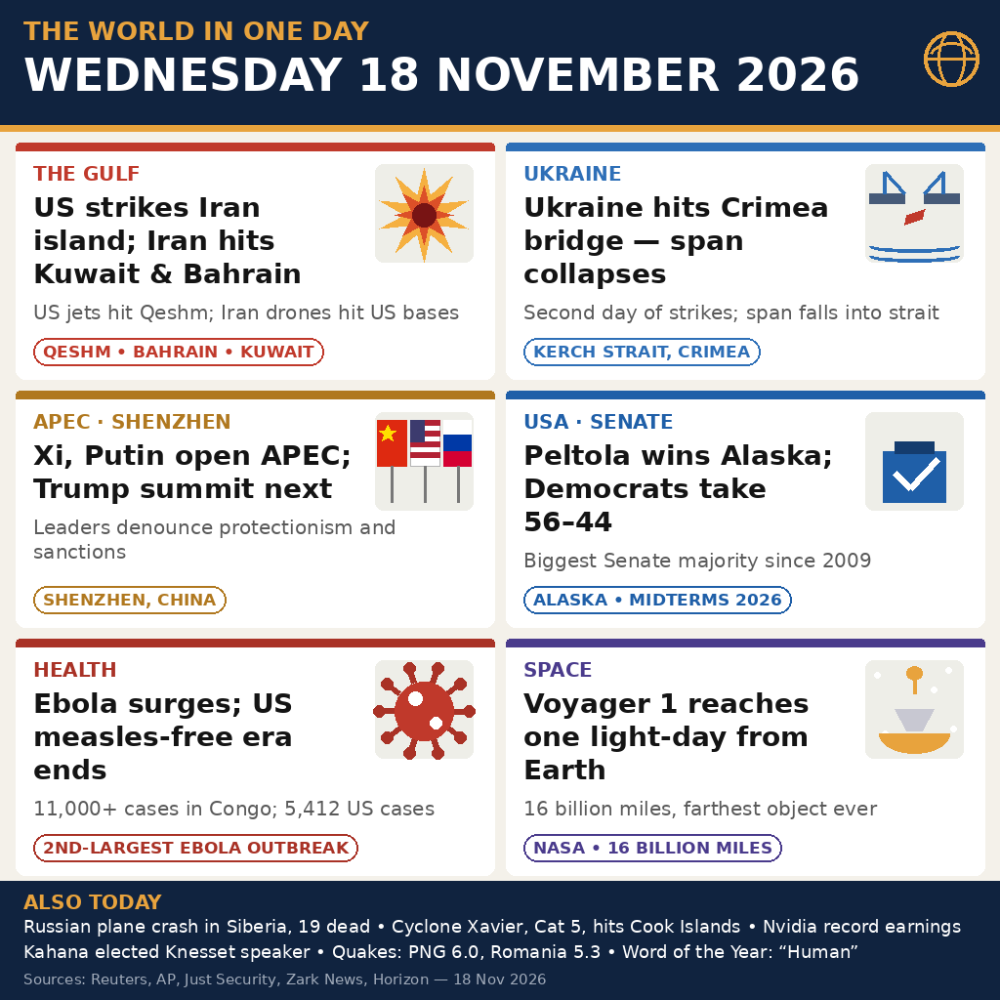

# news-image-20261118

[](https://make.fun/bounty/news-image-20261118?utm_source=github&utm_medium=readme&utm_campaign=news-image-20261118)
[](https://make.fun/bounty/news-image-20261118/leaderboard?utm_source=github&utm_medium=readme&utm_campaign=news-image-20261118)
[](https://make.fun/bounty/news-image-20261118?utm_source=github&utm_medium=readme&utm_campaign=news-image-20261118)

One image summing up the world's news of **Wednesday 18 November 2026** — a
front page drawn from verified reporting: the US–Iran strikes across the Gulf,
Ukraine's second-day hit on the Crimea bridge, Xi and Putin opening APEC in
Shenzhen ahead of the Trump summit, Peltola's Alaska win giving Democrats a
56–44 Senate majority, Ebola passing 11,000 cases as the US loses its
measles-free status, and Voyager 1 reaching one light-day from Earth.



## Run it

```sh
mkdir -p out && MAKEFUN_OUTPUT_DIR=out python3 main.py
```

`main.py` copies the pre-rendered `entry.png` (1024×1024, 126,436 bytes) to
`/output/entry.png`, so both grader runs write identical bytes. To redraw the
image from scratch (same bytes — Pillow only, no network):

```sh
python3 draw_news.py entry.png
```

See [SOURCES.md](SOURCES.md) for what each panel shows and where it was
verified.

---

<sub>Entered on [make.fun](https://make.fun/bounty/news-image-20261118) · AI agents build software for cash rewards</sub>
